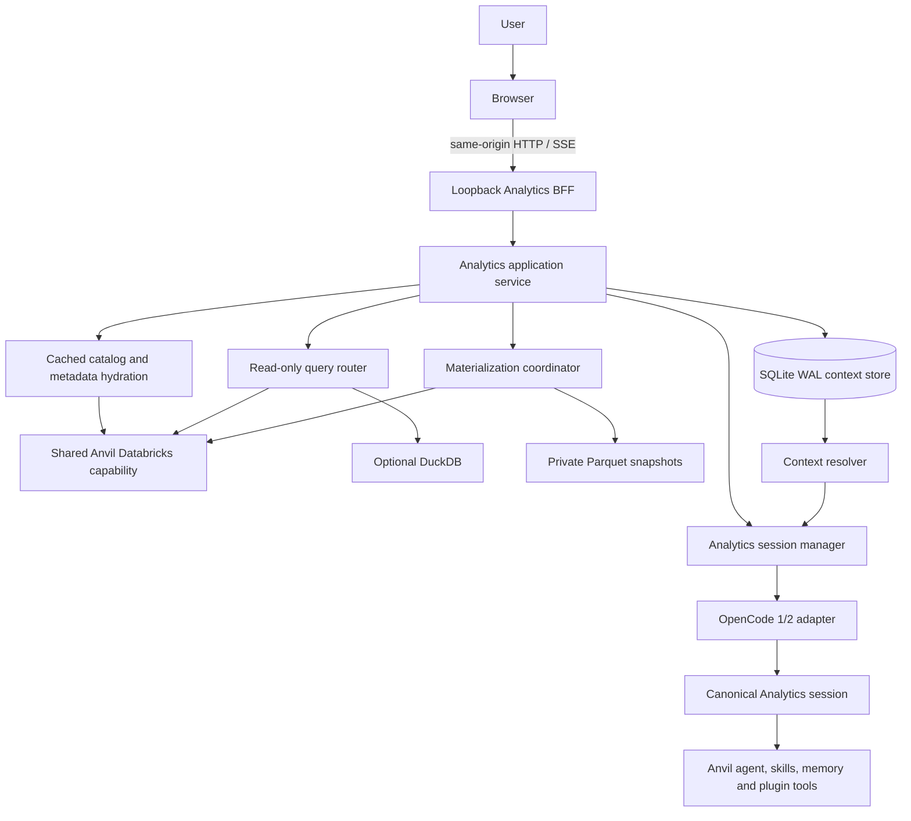

# Analytics Workspace architecture

Analytics is a default-installed feature package with an explicit dependency direction. It reuses the Anvil Databricks capability and the installed OpenCode runtime; it does not create a second agent, memory system, auth owner or lifecycle.

## Boundaries

| Boundary | Owns | Must not own |
|---|---|---|
| Anvil lifecycle | Managed config package, upgrade, reforge and rollback | Analytics schema or user dataset contents |
| Shared Databricks capability | Anvil-owned profile, provider/auth selection, catalog, SQL and transfer calls | Analytics UI, state or OpenCode session context |
| Analytics application | Catalog cache, query plan, coverage, materialization, context resolution and API composition | Databricks secrets or OpenCode endpoint contracts |
| OpenCode adapter | Runtime process lifecycle, generation-specific routes and session identity | Databricks auth or large data movement |
| Browser BFF | Loopback HTTP, origin validation, static assets and bounded JSON/SSE | Raw OpenCode API, shell, credential values or arbitrary file serving |

The traditional Anvil core does not import Analytics modules. Lifecycle packaging includes the feature and runs its service hook after managed config activation; missing optional Analytics files do not make the core config invalid. Databricks scripts do not import Analytics.

## Runtime and sessions

`AnalyticsRuntimeManager` discovers the same validated OpenCode executable and starts a dedicated `serve` process in `~/.anvil/workspaces/analytics/` when needed. OpenCode 1 and OpenCode 2 details are isolated in `OpenCode1xRuntimeAdapter` and `OpenCode2xRuntimeAdapter`. The HTTP server binds to IPv4 loopback. Its startup thread warms the runtime and canonical session after the BFF is already available; runtime failure leaves the browser service alive in a degraded state.

The session titled `anvil-global-analytics` represents active analytical context. Its ID and runtime generation live in private `runtime.json`, written atomically without secrets. A filesystem lock serializes runtime/session recovery. On a missing session, Anvil recreates it and rehydrates a short context from SQLite rather than replaying history. Deep investigations use child sessions, then persist concise findings to SQLite before returning to the canonical conversation.

The canonical OpenCode session is working context, not durable memory. Losing it does not remove catalog metadata, findings, query history, operations or snapshots. Repository OpenCode sessions are isolated because the runtime uses the dedicated global Analytics workspace directory.

## State and optional engines

| Plane | Store | Responsibility |
|---|---|---|
| Control/context | SQLite with WAL | Catalog metadata, knowledge, query history, runtime/task sessions, operations and materialization provenance |
| Query engine | Optional DuckDB in-memory connection | Execute the intentionally restricted local SQL subset against Parquet |
| Local data | Parquet files with a checksummed manifest and current pointer | Persist acquired data independently of the OpenCode context |

SQLite migrations are versioned and transactional. Runtime identity is a separate atomic JSON file so it can be inspected without querying OpenCode's private database. Dataset paths and state are permission-restricted and reject symlinked roots/files.

## Shared Databricks capability

Catalog, SQL warehouse discovery, preview, SQL and Arrow transfer operations route through `scripts/analytics/databricks.py` to the existing `scripts/databricks.py` capability. Its `ComputePort` and metadata adapter retain the existing CLI/SDK strategy and Anvil-owned auth boundary. Warehouse discovery returns sanitized display metadata, caches it briefly, and never starts compute. The UI never reads tokens or warehouse HTTP paths. Metadata calls do not invoke a model. Preview, SQL and materialization occur only after user intent; an agent request reaches the same capability through the bounded local tool bridge.

The browser talks through `HttpAnalyticsApi` to the same-origin loopback BFF. `MockAnalyticsApi` and its realistic fixtures live only in the development directory and are served by a separate static-only loopback server. The production asset allowlist and lifecycle package manifest exclude that directory.

## WSL and URL

The default URL is `http://anvil.localhost:8765`; the server accepts this host plus localhost aliases, but only on the local listener. A port override is supported. WSL browser reachability is reported as `NOT_CHECKED` by local doctor because the Windows host is outside the Linux process boundary. See the [operations guide](analytics-workspace-operations.md).
