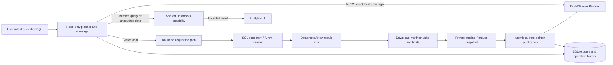

# Analytics Workspace data plane

The control plane chooses work and records evidence; the data plane performs deterministic acquisition and query execution. Large result sets do not pass through OpenCode or an LLM.

## Query routes

Every route accepts one read-only SQL statement. Anvil rejects mutation words, multiple statements, comments and unsupported characters before the provider call. The remote result is capped at 100 rows and 1,000,000 serialized bytes. Query history stores SQL, a fingerprint, actual route, latency, rows/bytes and success/error state in SQLite.

- **AUTO** uses local DuckDB only for a single-source query in Anvil's deliberately small provable subset and only if snapshot coverage matches source, projection and normalized filter. Otherwise it falls back to Databricks.
- **LOCAL** fails if DuckDB is unavailable or exact coverage cannot be proven; it never silently sends a requested local query remotely.
- **DATABRICKS** uses the existing shared provider and the explicitly selected SQL warehouse. If it is STOPPED, Anvil sends one start request and polls through STARTING/STOPPING until RUNNING or a bounded timeout; a permission denial gives the user local/other-warehouse/manual-start choices. A LOCAL route never starts compute.
- **Explain** reports the planned route, coverage and reason without executing SQL.
- **Compare** executes the same bounded query locally and remotely. It reports equality only when both complete bounded result sets and column sets are available; truncation produces `INCONCLUSIVE`.

The local parser intentionally defers joins, CTEs, unions, grouping, windowing and expressions outside the supported subset to the remote route. This limits what Anvil can prove; it does not claim all SQL can run locally.

## Catalog and preview

Catalog/schema/table metadata uses the shared Unity Catalog capability with pagination and atomic cache updates. On service startup, the browser can read cached state immediately while bounded background hydration refreshes catalogs, schemas, and tables/views. Each scope has persisted NOT_LOADED/PENDING/LOADING/READY/EMPTY/FAILED state, attempt time, reason code and object count; the tree also persists its phase and completed/total scope progress. Provider calls are bounded to two concurrent requests and retry only retryable provider failures with jitter. Service cancellation leaves the tree pending for a later restart. A user-expanded scope is fetched immediately if background work has not reached it. The Unity Catalog tables API has a maximum page size of 50, so table listings request at most 50 objects per page and follow the continuation token. Refresh replaces each complete scope atomically and removes disappeared catalog/schema/table descendants. Permission failures become browse-only state, never EMPTY. Columns hydrate only when requested. SQL warehouse listing and detail use the same existing shared capability, with a short-lived in-memory cache and response fields limited to ID, name, state, type and size. Preview is a separate user-requested remote read capped at 100 rows; it does not create a snapshot or imply local coverage.

Metadata failure keeps the prior cache and reports browse-only status. `search_catalog` searches all cached levels locally. It does not issue a remote wildcard scan or invoke an LLM.

## Make local and transfer

An acquisition request includes a fully-qualified source table, selected columns, optional supported filter, source version, selected warehouse, principal and row/byte limits. Defaults are 100,000 rows and 512 MiB; the service enforces up to 1,000,000 rows and 1 GiB. A full-table selection requires explicit confirmation and OpenCode materialization tools require an additional user approval prompt. Free disk space is checked before transfer.

The shared Databricks capability submits one read-only statement and returns bounded Arrow result metadata/links. Analytics downloads those links directly to its private data plane using a no-redirect client; result bytes are not sent through the model. Each chunk has checksums and is checkpointed for resume. Repeated chunks, corrupt payloads, excessive rows/bytes, incomplete manifests or disk failure stop publication.

Chunks are converted to Parquet under a private staging snapshot. Anvil validates files/manifest and atomically switches the current snapshot pointer only after all chunks succeed. The prior snapshot remains current on failure. Duplicate plans are idempotent; force-refresh creates a distinct operation. Interrupted transfers can resume by operation ID; unknown Databricks submission state requires a new explicit operation rather than risking duplicate acquisition.

## Coverage and consistency

Coverage refers to the current committed snapshot, its recorded workspace/source/version/projection/filter and completion state. Partial or malformed snapshots are never reported as complete. A selected filter must match exactly; projected and predicate columns must exist in the snapshot. Table metadata version can be unavailable, in which case the plan records `UNVERIFIED`; users can refresh metadata and explicitly refresh their local snapshot when data needs to be current.

Refresh metadata updates catalog state only. Refresh local repeats or resumes a materialization. Neither operation silently downloads all data. A snapshot is an explicit local copy at its recorded acquisition point; it is not a live mirror of Databricks.

## Lineage and profiling

`profile_table` derives null/distinct/min/max summaries from a bounded preview of at most 100 rows and does not return the raw sample in its profile response. `get_lineage` issues a bounded read against `system.access.table_lineage`; availability depends on workspace permissions and system-table data. Databricks describes this table as observed lineage events with limited coverage and retention, so absence of a row is not proof that no dependency exists. See [Databricks lineage system tables](https://docs.databricks.com/aws/en/admin/system-tables/lineage).

## Storage separation

| Data | Location | Format |
|---|---|---|
| Runtime identity and canonical session ID | `~/.anvil/analytics/runtime.json` | Atomic JSON, no secrets |
| Catalog, findings, queries, sessions and operations | `~/.anvil/analytics/context.db` | SQLite WAL |
| Transfer staging and committed snapshots | `~/.anvil/analytics/datasets/` and `snapshots/` | Arrow during transfer, Parquet after commit |
| Dedicated OpenCode directory | `~/.anvil/workspaces/analytics/` | OpenCode-owned workspace files |

All Analytics user data is outside managed OpenCode config and Anvil backups/rollback. Files and directories are private to the current OS user. DuckDB and PyArrow are required feature dependencies in a content-addressed, release-pinned Python environment prepared and import-validated by Anvil before service activation. The exact lock is installed with the managed package; neither package is installed into the system Python.
