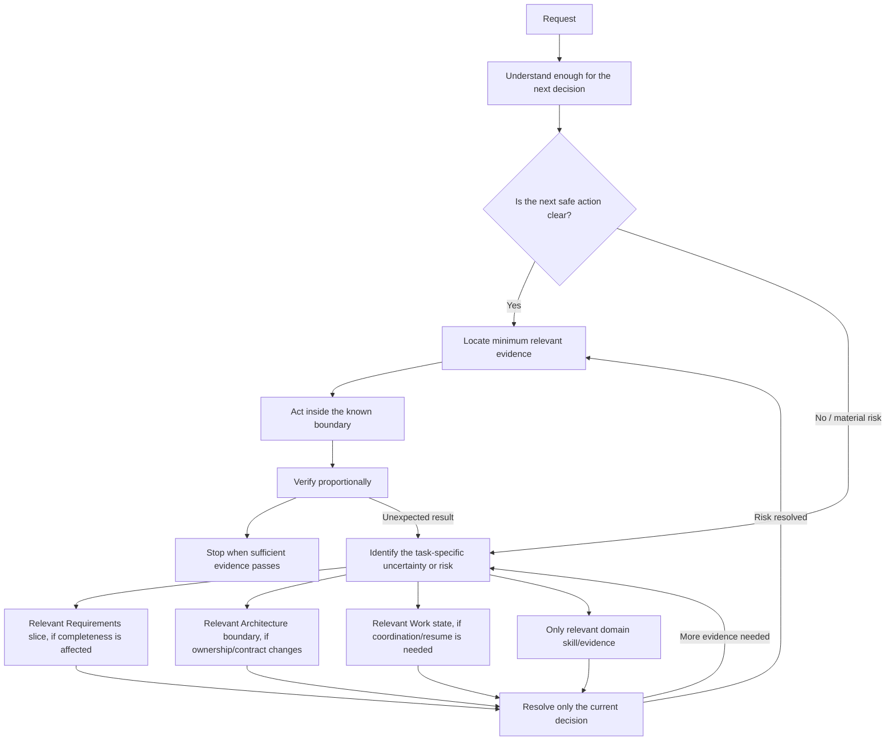

# Architecture

## Responsibility boundary

OpenCode owns providers, model selection, authentication, sessions, TUI, filesystem and shell execution, runtime state, and native compaction. Anvil owns the user-global harness, lifecycle safety, allowlisted skills, explicit Markdown memory, source registry, and runtime-independent task workflows.

The repository-wide component inventory, state/data-flow map, public target inventory and external dependencies are maintained in the [Anvil system map](system-map.md). The [full-system quality audit](quality-audit.md) records tested confidence, lifecycle evidence and unverified integration boundaries.

`scripts/lifecycle_state.py` is the shared local evaluator for Anvil-managed config, installation metadata, runtime, memory, verified backups, and pending lifecycle transactions. It evaluates the installed profile against its recorded source release, compares source and checkout versions semantically, and reports `MIGRATION_REQUIRED`, `UNSUPPORTED`, `CORRUPTED`, or `RECOVERY_REQUIRED` separately. Databricks readiness remains a separate optional integration state. The public command surface and exit behavior are documented in the [command contract matrix](command-contracts.md).

Anvil's product release is independent of the OpenCode major. `config/runtime-policy.json` records supported runtime majors, minimum versions, the first-install default, and the prohibition on automatic major upgrades. `scripts/runtime.py` centralizes runtime inspection and capability reporting. The V1 and V2 config templates live beside each other; common `AGENTS.md`, commands, skills, memory helpers and source registry are shared.

## Lifecycle and managed configuration

Anvil versions, installed config, and transitions are separate facts. The source config is audited for its runtime generation and source-release invariants; a staged target is audited strictly against the current release. The supported automatic source window is the same Anvil major and current plus four prior minor releases; 2.10 retains the 2.6 source line supported by 2.9. A checkout older than the installed Anvil release is unsupported; both upgrade and reforge reject it before taking a snapshot or changing managed files.

New installations include `.anvil-managed.json`, a manifest of Anvil-owned paths and file hashes. The installation record pins the manifest hash. Integrity checks follow the manifest or the deterministic inventory for a supported legacy source; filesystem location alone does not imply Anvil ownership. Unowned files, package-manager trees, and symlinks are not followed or hashed as managed state. Rebuilds preserve regular extras and symlink objects, including broken links, without resolving their targets. If a new target path collides with a user-owned path, planning stops before any live change. Reforge can repair missing, changed, or symlink-replaced managed files when ownership remains trustworthy; it refuses an unreadable or altered manifest and an untrusted profile source.

`config/managed-inventory.json` versions the introduction release for shipped skills and commands. Inline agent ownership is recorded with the managed manifest, so migrations can preserve user-defined disabled agents and remove retired Anvil-owned agents without relying on a whole-set equality test.

After a verified snapshot, a durable transaction journal records the transition and snapshot before Anvil activates a sibling-staged config directory by rename. A hard interruption is reported as `RECOVERY_REQUIRED`. The next lifecycle operation, after OpenCode is closed, verifies and restores that snapshot before retrying. `inspect` and `DRY_RUN=1` never write live paths; dry run refuses to perform pending recovery.

Upgrade preflight verifies both backup capacity and write/search access to the config parent used for the atomic directory swap. A read-only parent is reported before process shutdown, snapshot creation, or transaction journaling.

The managed config lives at `$XDG_CONFIG_HOME/opencode` (default `~/.config/opencode`). OpenCode data is under `$XDG_DATA_HOME/opencode`; state is under `$XDG_STATE_HOME/opencode`. Anvil memory, knowledge, source registry, installation metadata and backups are separate under `$XDG_DATA_HOME/anvil`. The knowledge directory is not the memory store.

Project, system-managed, and organization settings are outside Anvil's global ownership boundary. They may affect effective behavior; inspect and doctor report visible project overrides without deleting user or team files.

## Runtime profiles and agent policy

OpenCode 1 uses its singular `agent`, `permission`, and `plugin` config fields. Anvil defines one model-neutral `anvil` primary agent, denies `task`, prompts for sensitive `.env` reads and destructive Git shell operations, and allowlists only the shipped Anvil skills. The global plugin list is empty for this profile.

OpenCode 2 uses plural `agents` and `plugins` fields and ordered permissions. It defines the same model-neutral primary agent, denies subagents, prompts for sensitive `.env` reads and destructive Git shell operations, and allowlists the same shipped skills plus one memory-search tool. No global MCP servers are enabled by default. Neither profile pins a model or replaces the provider's native system prompt.

## Capabilities and progressive enhancement

Callers use the central capability record rather than treating every Anvil release as one OpenCode generation. OpenCode 2 adds the local `anvil-core` plugin, native `anvil-knowledge` Reference, ordered permissions, bounded tool output, and structured stats JSON. OpenCode 1 uses its native config, commands/skills, and text stats; shared Python memory search and direct reads of explicitly named knowledge files provide the fallbacks. `scripts/capabilities.py` combines runtime, local/cached Databricks, and Anvil communication/artifact capabilities in one text or JSON result. Inventory commands do not contact Databricks; they show cached capability evidence and mark it stale after 15 minutes.

## Adaptive engineering depth and long-horizon continuity

The requested change governs activation; project size and existing task state do not. The always-loaded kernel keeps the understand/locate/act/proportionally-verify/stop loop. A task-local request normally leaves requirements, architecture and work state dormant even in a complex repository. Material uncertainty, public/component boundaries, persistent state, migrations, failure ownership or explicit continuation load only the relevant branch. Engineering depth rises or falls with the current decision.

For genuine long-horizon work, the lazy `anvil-engineering` skill still provides separate Requirements, Architecture and Work models in atomic task state under XDG_STATE_HOME/anvil/engineering. Resume and completion gates remain strict. Architecture evidence is invalidated by changes inside its declared scope and milestone checkpoints evaluate only missing or stale relevant invariants; explicit unscoped `checkpoint` remains a full audit. These models remain independent of durable memory, lifecycle transactions and OpenCode compaction. [Core contracts](engineering-internals.md), [adaptive policy](adaptive-engineering.md), and [user guidance](engineering.md) describe operation and activation.



The agent owns semantic scope/risk judgment, specification extraction, design and diagnosis. Deterministic modules own state integrity, dependencies, coverage, mechanically testable invariants, command evidence, path-scoped stale detection and completion. Architecture protects declared boundaries; it does not supervise private helpers. Semantic reviews are attributed judgments, never mislabeled as observed tests. Resume reconstructs a bounded packet and executes nothing; partial effects require inspection/reconciliation. The compact task-local loop is always loaded; direct work leaves unrelated long-horizon state dormant. Native runtime ownership, permissions, plugins and memory remain unchanged.

## Public command presentation

Databricks domain operations return structured results. `databricks_providers/presentation.py` formats those results for people, while `--format json` returns the structured result for scripts. `VERBOSE=1` adds provider diagnostics; default output emphasizes readiness, warnings, and next steps. Presenters do not own provider or auth decisions. Setup, `status`, and doctor consume the same readiness engine. Doctor performs bounded, read-only identity and core-list requests when a profile exists; with no Anvil profile it remains local and reports `NOT_CONFIGURED`. Capabilities remains local and reports Supported, Available, and Verified separately.

The V2 plugin uses the OpenCode 2 API to register only bounded, read-only `anvil_memory_search`. It does not add context hooks, prompt mutation, model routing, retries, memory writes, or custom compaction. Capabilities are visible through `make capabilities` and `make doctor`.

## Skills and commands

Native lazy skills cover memory, Spark performance, Delta Lake, Databricks, data ingestion, evidence-backed communication artifacts, engineering continuity and system design. Native Markdown commands provide `/remember`, `/recall`, `/distill`, and a generic `/review`, all assigned to the Anvil agent. Persistent memory writes require explicit `/remember`, `/distill`, or direct user intent.

## Communication and artifact intelligence

The model-independent `scripts/communication` package provides bounded, standard-library contracts for source discovery and extraction, evidence and finding provenance, reproducible quantitative analysis, audience/constraint planning, Markdown materialization, architecture semantics and SVG, and deterministic artifact review. The lazy `anvil-communication` skill keeps natural language as the user interface; it guides the model to read only named inputs, synthesize evidence, prepare the plan, and ask before materializing when the request leaves an important decision open. The `/review` command reviews an explicitly named existing artifact without modifying it.

`make capabilities` reports supported source types and output renderers. Markdown reports and slide outlines and accessible architecture SVG are available. DOCX/PPTX/PDF binary rendering, chart rendering, OCR, embedded-media interpretation, and animation are not claimed. PDF text extraction requires the optional local `pdftotext` utility. The helper does no remote source discovery, Databricks query, or memory write on its own; remote evidence remains subject to existing explicit provider workflows.

The plan validator recomputes derived numeric fields from observations, requires measured values and diagram claims to resolve to provenance records, checks audience and hard-constraint structure, and keeps `semantic_claim_review: PENDING_MODEL` for the model/human reviewer. SVG layout validation rejects node collisions and edges crossing unrelated nodes; this deterministic check does not claim aesthetic quality.

## Databricks capability

Anvil 2.6's optional Databricks capability uses a per-capability resolver with an Anvil-owned configuration boundary. Setup gathers a workspace URL and environment label, stages `${XDG_CONFIG_HOME:-$HOME/.config}/anvil/databricks/databrickscfg`, creates an `anvil-*` profile, resolves cloud and topology, authenticates, validates the staged profile, and only then atomically activates it. External `.databrickscfg` profiles are diagnostic-only; they are never adopted, modified, or reauthenticated by Anvil. Existing Anvil provider metadata is stored separately in `anvil/databricks.json` and records profile ownership, workspace, authentication strategy, and provider without credentials.

The CLI and Python SDK run with the same `DATABRICKS_CONFIG_FILE` and selected `DATABRICKS_CONFIG_PROFILE`. The shared environment wrapper removes inherited `DATABRICKS_*` values from Anvil child processes, so a user token or host override cannot silently supersede the selected Anvil profile. Azure workspaces prefer an existing Azure CLI session; remote contexts can use device-code login and local contexts can use Azure CLI interactive login. Databricks CLI OAuth U2M remains a supported fallback where topology permits it. Native CLI/SDK credential storage owns the resulting credentials. An optional SQL Connector uses its own supported OAuth U2M path because it does not consume the shared SDK profile; it remains a specialized provider. Databricks Connect is also specialized, and VS Code is assisted only.

Databricks setup follows composable boundaries: `owned_config.py` owns config paths, environment isolation, staging and atomic writes; `topology.py` detects the execution context; `auth_strategy.py` selects a documented flow; `auth.py` runs official CLI/cloud authentication with a bounded progress watchdog; `readiness.py` advances explicit readiness states; and the presenter renders the result. Setup and a later session share `json_from_cli`, the deterministic resolver, normalized errors, the child environment, operation-specific timeouts, and bounded process runner. READY requires identity validation plus verified cluster-list and warehouse-list results; running compute and SQL/system-table access are not required. During explicit setup, a provider-specific CLI health failure may prepare the isolated SDK and repeat those same production probes; shared failures stop without fallback. The validated absolute SDK interpreter is reused across processes. Azure CLI auth is restricted to Azure workspaces and is configured as `auth_type=azure-cli` in the Anvil profile for supported Unified Authentication providers. Remote AWS/GCP or headless sessions do not select loopback browser auth. The official VS Code extension remains assisted; Anvil does not automate UI or inspect private IDE credentials.

Readiness advances only with evidence at each transition:

```text
CONFIGURED
  → AUTHENTICATED
  → WORKSPACE_VALIDATED
  → PROVIDER_VALIDATED
  → CAPABILITIES_DISCOVERED
  → READY
```

Configuration validation proves the Anvil-owned profile and host; authentication validation proves the intended credentials work; workspace validation requires a current-user response for that host; provider validation requires a production adapter call; capability discovery verifies both cluster and warehouse lists. A successful empty list is valid. Permissions remain attached to the individual capability. See the [readiness contract](databricks/readiness.md) for error scopes, fallback rules, freshness, and timeout budgets.

CLI installation is attempted only by an explicit `make databricks-setup`; the user-local executable is downloaded from official releases and SHA-256 checked. General reforge and upgrade flows neither install Databricks clients nor probe workspace auth. Discovery remembers a verified absolute CLI path and reports whether it is visible through the current `PATH`. Provider health is revalidated when used. The integration works with OpenCode 1 and 2 and adds no plugin, MCP, or model dependency.

The Databricks skill references a dated official system-table snapshot, focused schema notes, and query recipes. Live workspace discovery takes precedence for a task. SQL recipes aggregate and bound operational data before it enters model context. Remote execution requires a clear user request; compute and workload mutations are not exposed by the adapter, and stopped compute is never started automatically. FinOps output distinguishes measured usage identifiers, list-price estimates, and approximate shared-compute allocation, with a deterministic evidence-quality score.

## Lifecycle dependency matrix

| Command | Network required | May mutate OpenCode | May download OpenCode | Release lookup |
|---|---:|---:|---:|---:|
| `make inspect` | No | No | No | No |
| `make test` | No | No | No | No |
| `make reforge` with a healthy runtime | No | No; reuses exact runtime | No | No |
| `make reforge` without a runtime | Yes, for provisioning | Yes; first install only | Yes | Yes |
| `make upgrade` | No | No; config and Anvil metadata only | No | No |
| `make update-runtime` | Yes | Yes | Yes | Yes, same major |
| `make migrate-runtime OPENCODE_MAJOR=N` | Yes | Yes | Yes | Yes, requested major |
| `make doctor` | Conditional* | No | No | No |
| `make capabilities` | No | No | No | No |
| `make stats` | No | No | No | No |
| `make rollback` | No | Only when the selected backup has runtime scope | No | No |
| `make databricks-setup DRY_RUN=1` | No | No | No | No |
| `make databricks-setup` | May, for provider installation or workspace validation | No | No OpenCode; may install Databricks CLI/SDK | No OpenCode lookup |

`make upgrade` validates local runtime and config, stages the Anvil target, rehearses against copied state, and checks that the backup path is safe and has enough space before it asks to stop OpenCode. Read-only process discovery identifies only the validated executable, same user, and matching configured OpenCode data roots. If the upgrade is running under a matched OpenCode ancestor, it aborts. After the cancellable countdown it sends SIGTERM, waits a bounded interval, uses SIGKILL only as a fallback, verifies that no matched process remains, then creates the Anvil-scoped backup and applies files. It preserves the exact OpenCode executable/version, OpenCode data/state, and Databricks preferences. `DRY_RUN=1` performs the discovery and reports process count without sending signals, writing runtime state, creating backups, or changing live files. OpenCode remains stopped after a real upgrade and must be started normally by the user.

`make upgrade` also prints an owned-file source-to-target plan. It identifies additions, changed files, removals, unchanged managed files, and preserved user files. It does not treat target-only files as evidence that a compatible source install is corrupted.

`make update-runtime` owns same-major runtime resolution and installation. It rehearses the new executable against the installed config and copied user state, backs up runtime/config/data/state, installs the candidate, runs doctor, and rolls back on failure while retaining the installed Anvil release and config manifest. `make migrate-runtime OPENCODE_MAJOR=N` is the explicit major change and rebuilds the Anvil config adapter; it requires Anvil to be current. `make reforge` reuses the exact supported runtime already installed; only a genuinely fresh installation provisions OpenCode.

`make inspect`, `make doctor`, and `make capabilities` use central local runtime discovery. Doctor also probes Databricks read-only when an Anvil-owned profile is configured; without one, it stays local. `make capabilities` uses only local inventory and cached readiness evidence. Network-dependent runtime behavior is limited to fresh provisioning, `update-runtime`, and `migrate-runtime`; Databricks doctor requests are separate read-only workspace checks.

`*` `make doctor` makes bounded read-only identity, cluster-list, and warehouse-list requests only when an Anvil Databricks profile exists. See the [readiness contract](databricks/readiness.md) for state transitions, fallback rules, and operation timeouts.

## Backup and rollback boundary

Backups are private, timestamped directories under `$XDG_DATA_HOME/anvil/backups/`. Checksums cover each archived artifact and each manifest records Anvil-only or runtime scope. An Anvil-only snapshot restores Anvil config and metadata while leaving OpenCode executable/data/state untouched. Runtime snapshots restore the saved config, installer runtime, data, and state instead of attempting a database downgrade.

Anvil memory is outside the OpenCode config/runtime snapshot. Before rollback, current Markdown memory is archived separately under `$XDG_DATA_HOME/anvil/memory-backups/`, then remains at its normal path. Source registry and knowledge also remain in the Anvil data root.

## Memory and source registry

Markdown is the source of truth under `$XDG_DATA_HOME/anvil/memory/`. Historical entries remain readable without mass migration. Optional aliases, status, evidence, source sections, line ranges, repository and content-hash provenance are handled when present. Lexical search normalizes Unicode accents and falls back to the standard library when `rg` is unavailable.

The file-based source registry lives at `$XDG_DATA_HOME/anvil/sources/`, one atomic JSON record per explicitly distilled local source. It records source identity/hash, available Git metadata, timestamps and linked memory IDs. `/distill` inspects and plans only sources named by the user. Unchanged sources can be skipped; changed or missing sources mark linked memory as potentially stale and are surfaced for review instead of causing destructive rewrites. Knowledge files remain untouched.

Distillation is a model-guided semantic workflow defined in `config/commands/distill.md`, not an automatic parser or chunker. It asks the Anvil agent to assess claims, check relevant active code paths and tests where useful, distinguish normative requirements from implementation behavior, preserve meaningful conflicts and historical status, deduplicate, and record honest provenance. Deterministic tests cover the registry and workflow evidence rules, not an LLM's semantic quality.

## Runtime controls and installation record

Each installation record stores Anvil version separately from OpenCode runtime major/version and release artifact digest when available, plus the managed-config manifest checksum. Metadata is written after config activation. The local runtime-state cache stores an absolute executable path, version, generation, adapter, file identity hash, and verification time; discovery re-executes the binary and checks policy before use. Native stats use the current runtime interface and do not maintain a separate telemetry store. See [runtime compatibility](runtime-compatibility.md) for tested versions and capability gaps.
