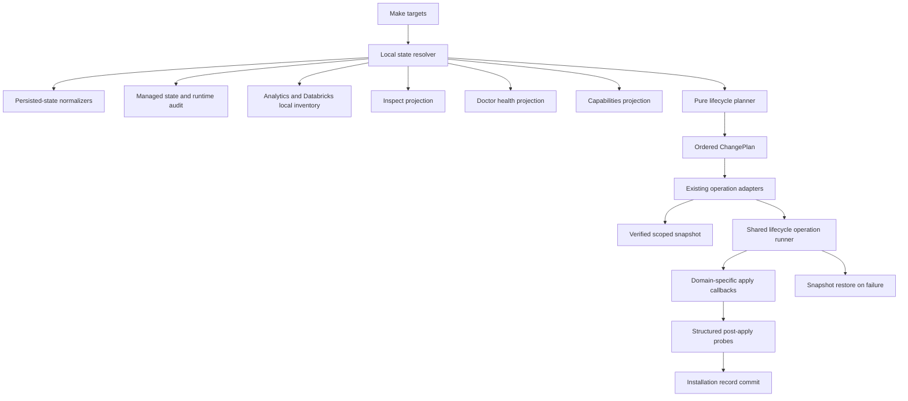

# Lifecycle architecture

Anvil has two independent version axes: the Anvil product release (`VERSION` and `installation.json.anvil_version`) and the OpenCode runtime version/generation. A product upgrade must preserve the validated OpenCode executable; a same-major runtime update must preserve the installed product release. A major runtime migration explicitly changes the adapter profile.

## Boundaries

`scripts/lifecycle_model.py` normalizes the real installation record (schema 3), managed manifest (schema 1), runtime record (schema 1), Analytics session (schema 1), Databricks provider state (schema 3), and Memory directory. Every document has a `CURRENT`, `LEGACY`, `NOT_PRESENT`, `INVALID`, or `UNSUPPORTED` status. Unknown newer schemas are never treated as empty current state. Secret-bearing Databricks values are not copied into the typed projection.

`scripts/lifecycle_migrations.py` is the explicit installation-record registry for schema 1→2→3. It transforms records in memory and is idempotent; `installation.py` still owns the atomic write at commit. Unsupported newer schemas stop before a record is overwritten. Other persisted documents are normalized for inspection but retain their module-specific write/migration owner.

`scripts/lifecycle_resolver.py` combines normalized persisted state with the existing managed-file/runtime audit and local Analytics/Databricks discovery. It makes no remote provider request or installed-state write. `inspect`, `doctor`, and `capabilities` now call this boundary; doctor may additionally perform its explicitly labelled live Databricks probe and local runtime smoke test. The output formats remain compatible while their discovery paths converge. Analytics API response sections are shape-checked before rendering.

`scripts/lifecycle_plan.py` defines operation-specific `DesiredState`, semantic operations, and ordered, schema-versioned `ChangePlan`. Its `plan(current, desired)` function is pure. Product, reforge, runtime and public rollback adapters persist the exact generated plan in a private temporary file; runtime plans explicitly target the installed Anvil release and runtime major. `scripts/lifecycle_executor.py` parses the file back into typed operations, rejects malformed, blocked, mismatched, incomplete, unexpected, or non-private plans, and derives config-versus-runtime journal phases from those operations. Adapters assert that physical callbacks do not request semantic operations absent from that plan. Product, reforge and runtime dry-run render the exact accepted plan; first-install reforge planning is local and does not resolve a runtime release. A plan validates snapshot-first ordering for mutations, restore-then-verify ordering for rollback, no duplicate semantic operations, and the installation-record commit last. `scripts/lib/lifecycle-operation.sh` owns the post-snapshot execution sequence for product/runtime changes: validate the supplied plan and verified snapshot, journal begin, ordered phase transitions, apply callback, structured verification, metadata commit, and automatic snapshot restore on failure. Adapters retain domain-specific apply/commit callbacks and preflight approval/quiescence.

`scripts/lifecycle_contributors.py` keeps real module boundaries small. OpenCode contributes runtime discovery, runtime change operations, and exact-version verification. Analytics contributes local readiness, dependency/service plan operations, and local verification. Databricks contributes local provider inventory and setup intent without authentication during inspection. Memory contributes initialization intent and root verification. Contributors return facts or semantic operations; none starts a transaction or applies a change.

`scripts/lifecycle_verify.py` is independent of `doctor.sh`. It checks the managed manifest, current or source-compatible OpenCode profile, exact supported runtime version/generation, Memory root, and Analytics dependencies/service when production Analytics is installed. Product, reforge and runtime adapters now verify before writing installation metadata; public and automatic rollback verify restored state before clearing or completing the journal. A failed apply verification triggers snapshot restore; if restore verification also fails, the journal and snapshot remain for recovery. `doctor` remains a human health command and is no longer the transaction gate. Installation metadata plus runtime provenance are the commit point; the journal clears only after these writes succeed.

## Ownership and recovery

The release inventory pins Anvil-owned artifact hashes. The installed `.anvil-managed.json` identifies ownership; unknown files, plugins, provider settings, memory, credentials and project overrides remain user-owned. A regular owned file with a verified replacement is repairable through `upgrade` with an exact pre-operation snapshot. Symlink substitution, invalid ownership metadata, and conflicting user-owned target paths block automatic replacement. `reforge` rebuilds the installed release when it matches the checkout; a release change belongs to `upgrade`. Rollback restores the verified snapshot scope recorded at the start of the operation.

Snapshot preparation remains in command adapters because product, reforge, and runtime scopes differ. Public rollback consumes and validates its exact restore/verify plan, then retains explicit restore steps and structured post-restore verification because rollback cannot safely invoke itself as an automatic rollback callback. The Make targets run pure contributor planning preflights before Analytics service convergence and Databricks setup. Those modules retain ownership of staged service/provider apply; their physical operations are not yet orchestrated by `lifecycle-operation.sh`.

Each journaled mutation now has an operation ID and an ordered, bounded list of phase timestamps. `lifecycle_transaction.py` enforces operation-specific phase transitions, including a distinct restore and verification path for rollback. These contain no credential values. The journal is removed after a successful commit or verified rollback; a durable cross-operation history is not yet implemented.

## Certification

`tests/lifecycle_model.py` covers absent, current, legacy scalar, malformed, nested invalid and newer-schema documents. `tests/lifecycle_plan.py` checks purity, ordering, blockers, rollback and product/runtime separation. `tests/lifecycle_execution.py` checks that the executor consumes a schema-versioned private plan and rejects blocked, mismatched and incomplete plans. `tests/lifecycle.py` has previous-release and malformed-state observation cases in addition to staged upgrade, managed drift, first install, runtime transition, interruption and rollback scenarios. `make test` uses isolated HOME/XDG roots and fake runtime/provider binaries. The test environment skips real Analytics dependency installation; a live deployment must still pass local service readiness in post-apply verification.

## Remaining architecture work

The shared executor owns journal order, verification-before-commit, plan gating, and automatic rollback for product/runtime operations; domain-specific apply code remains in `anvil_upgrade.sh`, `reforge.sh`, and `upgrade.sh`, while public `rollback.sh` retains its explicit restore sequence and verifies its planned restore. Analytics and Databricks planning preflights use lifecycle contributors, while staged physical operations remain module-owned. `doctor_data.py` consumes the normalized Analytics readiness object directly. The module-owned physical apply flows and the lack of durable cross-operation history remain the main centralization boundaries.
