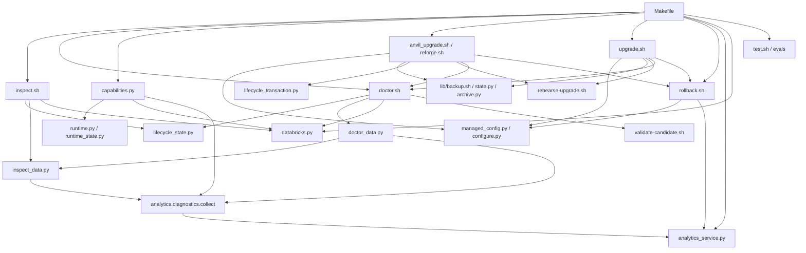
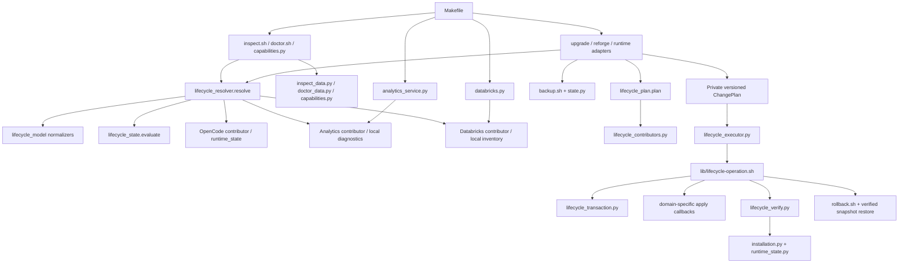

# Make target and lifecycle inventory

This is the pre-refactor inventory of the 24 targets in the current `Makefile` (Anvil 2.17.0). It describes the behavior of the checked-in entrypoints, including conditional effects. No recipe directly invokes another Make target. Tests and evaluators invoke Make in isolated fixtures.

## State and path key

| Key | Existing paths or resource |
| --- | --- |
| `P` | Checkout: `VERSION`, `config/`, `scripts/`, `web/`, fixtures and release inventory |
| `C` | `${XDG_CONFIG_HOME}/opencode`, including `.anvil-managed.json`, profile and installed helpers |
| `I` | `${XDG_DATA_HOME}/anvil/installation.json` and `runtime.json` |
| `O` | OpenCode executable, install root, data and state directories; shell PATH integration |
| `M` | `${XDG_DATA_HOME}/anvil/memory` and source registry |
| `B` | `${XDG_DATA_HOME}/anvil/backups` and lifecycle transaction journal |
| `A` | `~/.anvil/analytics`, isolated Analytics Python runtime and catalog/context state |
| `S` | User systemd unit or managed fallback PID/log files; loopback Analytics/OpenCode processes |
| `D` | Anvil Databricks preferences/profile, private CLI/SDK installation and cached readiness |
| `E` | Evaluation/certification report artifacts; the analytical baseline is checked into `evals/analytical/baselines/` |

`Local` network means only loopback health probes. `Conditional` means the operation may contact release/package/provider endpoints depending on installed state. DRY_RUN applies only where the current command accepts it; Make variables alone do not confer dry-run support.

## Complete command matrix

| Target | Family and purpose | Reads → writes | Runtime, service, dependencies | Network | OpenCode / Databricks needed | DRY_RUN / rollback | Direct entrypoint and relevant failure |
| --- | --- | --- | --- | --- | --- | --- | --- |
| `help` | Observe: command summary | `P:VERSION` → none | None | No | No / no | No / n.a. | Make recipe; stale help text can misstate semantics. |
| `inspect` | Observe: installed facts | `P,C,I,O,M,B,A,S,D`, project overrides → none | Reads runtime, service, dependency and local provider state | Local | No / no | n.a. / n.a. | `inspect.sh` → `lifecycle_state.py`, `inspect_data.py`, `databricks.py status --local`; malformed nested state or inconsistent probes can disagree. |
| `doctor` | Observe: health and recovery | `P,C,I,O,M,B,A,S,D`, project overrides → temporary rehearsal files only | May run bounded OpenCode smoke probe; reads service/dependencies | Local | No / no | n.a. / n.a. | `doctor.sh` → `lifecycle_state.py`, `runtime.py`, `databricks.py`, `doctor_data.py`, `validate-candidate.sh`; multiple independent discoveries and text statuses. |
| `capabilities` | Observe: usable features | `P,C,I,O,A,S,D` → none | Reads runtime adapter and Analytics readiness | Local | No / no | n.a. / n.a. | `capabilities.py` → `runtime.capabilities`, `databricks.local_status`, `analytics.diagnostics.collect`; parallel readiness interpretation can disagree with doctor. |
| `stats` | Observe: native usage summary | `O,I` → temporary output | Runs OpenCode stats when supported | No Anvil external request | Optional / no | n.a. / n.a. | `stats.sh` → `runtime.py`, `stats.py`; unsupported runtime prints fallback. |
| `analytics-status` | Observe: Analytics service | `C,A,S` → none | Reads user systemd/PID and loopback health | Local | No / no | n.a. / n.a. | `analytics_service.py status`; inactive or foreign service returns nonzero. |
| `upgrade` | Converge: target product release | `P,C,I,O,M,B,A,S,D` → `C,I,M,B,A,S` | Preserves OpenCode binary; may prepare Analytics dependencies, service and canonical session | Conditional package network; no OpenCode release lookup | Supported existing runtime / no | Yes / verified Anvil snapshot | `anvil_upgrade.sh` → `lifecycle_state`, `managed_config`, rehearsal, backup, transaction, `doctor.sh`; historically doctor was an apply-time verifier. |
| `reforge` | Converge: rebuild managed config | `P,C,I,O,M,B,A,S` → `C,I,M,B,A,S`, possibly `O`/PATH on first install | Reuses healthy runtime; may provision missing runtime and Analytics dependencies | Conditional release/package network | Optional existing / no | Yes / verified Anvil or runtime snapshot | `reforge.sh` → runtime resolution, config builder, backup, install, inspect/doctor; checkout release can differ from installed release. |
| `rollback` | Converge: restore snapshot | `C,I,O,M,B,A,S` → `C,I,O,A,S`, possibly PATH and OpenCode data/state for runtime scope | Stops/recovers runtime according to snapshot; service convergence may follow | No release lookup | Optional / no | No / consumes verified snapshot | `rollback.sh` → state/archive/managed merge/apply; missing, untrusted or conflicting snapshot blocks. |
| `update-runtime` | Runtime: same-major OpenCode update | `P,C,I,O,B,A,S` → `O,I,B`, possibly `C,A,S,PATH` | Release resolution, candidate validation, rehearsal and runtime snapshot | Yes | Existing supported / no | Yes / verified runtime snapshot | `upgrade.sh --update-runtime`; release endpoint/proxy and candidate incompatibility block before apply. |
| `migrate-runtime` | Runtime: explicit major transition | `P,C,I,O,B,A,S` → `O,C,I,B,A,S,PATH` | Builds target adapter config, stages candidate, rehearses and snapshots | Yes | Existing supported / no | Yes / verified runtime snapshot | `upgrade.sh --migrate-runtime`; requires `OPENCODE_MAJOR`, blocks implicit major changes. |
| `analytics` | Converge: ensure installed workspace | `C,A,S,O` → `A,S`, dedicated OpenCode session | Syncs unit, starts service and checks runtime/canonical session | Local; service may use configured providers later | Installed Analytics/OpenCode / no | No / no lifecycle snapshot | `analytics_service.py start`; missing dependencies or failed health blocks. |
| `analytics-stop` | Converge: stop managed service | `S` → `S` | Stops systemd unit or fallback process | Local | No / no | No / no | `analytics_service.py stop`; no owned process returns nonzero. |
| `databricks-setup` | Converge: Anvil-owned integration | `D,P`, provider environment → `D`, possibly private CLI/SDK | Provider installation, authentication, workspace/capability validation | Conditional external provider/package network | No / setup target | Yes; `RESET=1` scoped reset / staged config recovery, no lifecycle snapshot | `databricks.py setup`; missing CLI/SDK, auth, network, profile and workspace errors are distinct. |
| `analytics-dev` | Development: foreground server | `C,A,O,D` → development Analytics state | Starts foreground Analytics server | Local plus explicit provider use | Installed Analytics/OpenCode / optional | No / stop foreground process | `analytics_service.py dev`; occupied port or absent install blocks. |
| `analytics-ui-mock` | Development: mock UI server | `P:web/analytics` → temporary mock process | No installed runtime/service dependency | Local | No / no | No / stop foreground process | `analytics_ui_mock.py`; invalid scenario/port or occupied port blocks. |
| `test` | Validate: offline contract suite | `P` → temporary HOME/XDG and test reports | Uses fake runtimes/services | Loopback fixtures only; external network guard | No real runtime / no real provider | No / isolated fixtures | `test.sh` → `tests/run.sh`; missing test tools or failed fixtures block. |
| `eval-analytics` | Validate: Analytics certification | `P` → `E` (default `artifacts/analytics-certification`) | Fake OpenCode/Databricks, isolated lifecycle fixtures | Loopback fixtures | No real runtime / no real provider | No / report artifacts only | `evals.analytics.certify`; reports failed suite or missing optional Node check. |
| `eval-analytical` | Validate: deterministic analysis | `P`, optional dataset/truth → `E` | Local analytical fixtures | No | No / no | No / report artifacts only | `evals.analytical.cli run --mode deterministic`; invalid fixture/truth or scoring failure. |
| `eval-analytical-semantic` | Validate: adversarial semantics | `P` → `E` | Local certification and benchmark | No | No / no | No / report artifacts only | `evals.analytical.cli semantic`; release gate failure returns nonzero. |
| `eval-analytical-model` | Validate: blind model run | `P,O`, model and fixture → `E` | Invokes selected OpenCode model | Provider network conditional | Yes / optional through model | No / report artifacts only | `evals.analytical.cli run --mode model`; requires `MODEL`, runtime/provider access. |
| `eval-analytical-full` | Validate: deterministic plus blind model run | `P,O`, model and fixture → `E` | Local fixtures and selected OpenCode model | Provider network conditional | Yes / optional through model | No / report artifacts only | `evals.analytical.cli run --mode full`; requires `MODEL`, runtime/provider access. |
| `eval-analytical-baseline` | Validate: freeze deterministic baseline | `P` → `E` and one immutable repository baseline | Local fixtures/benchmark | No | No / no | No / no overwrite | `evals.analytical.cli run --freeze-baseline`; existing baseline refuses overwrite. |
| `eval-analytical-review` | Validate: apply human review overlay | Prior `E`, `REVIEW`, optional truth → new `E` | No runtime requirement | No | No / no | No / immutable new overlay | `evals.analytical.cli review`; invalid or missing report/review blocks. |

The Makefile had no `upgrade-runtime`, `test-all`, `test-all-full`, or `benchmark` target at this baseline. `update-runtime` was the existing same-major command; the refactor adds `upgrade-runtime` as a delegation alias. No public target is removed by this inventory.

## Post-refactor target responsibility matrix

The target set was re-read from the current Makefile after the refactor. It now has 25 public targets, including the `upgrade-runtime` compatibility alias. `test-all`, `test-all-full`, and `benchmark` remain absent and are not implied by Make variables or documentation.

| Target | Family | Mutates installed/user state | Network | DRY_RUN | Snapshot rollback | Current entrypoint / contract |
| --- | --- | --- | --- | --- | --- | --- |
| `help` | Observe | No | No | n.a. | n.a. | Makefile version and command summary. |
| `inspect` | Observe | No | No; local probes only | n.a. | n.a. | `inspect.sh` resolves a shared local snapshot and renders installed facts. |
| `doctor` | Observe | No intended installed-state mutation | No by default; bounded local probes | n.a. | n.a. | `doctor.sh` projects health and recovery advice; optional provider checks remain separately labelled. |
| `capabilities` | Observe | No | No; local probes only | n.a. | n.a. | `capabilities.py` projects availability from the common resolver and local readiness facts. |
| `stats` | Observe | No | No | n.a. | n.a. | `stats.sh` prints native stats when supported or first-use/runtime guidance. |
| `analytics-status` | Observe | No | Loopback only | n.a. | n.a. | `analytics_service.py status` reports managed service state. |
| `upgrade` | Converge | Yes: Anvil-managed config, memory initialization, install metadata | Package network only if required by release | Yes | Yes, verified Anvil snapshot | `anvil_upgrade.sh`; preserves exact validated OpenCode runtime; structured verify before commit. |
| `reforge` | Converge | Real run changes Anvil-managed profile/memory and may provision runtime/PATH; dry run changes no installed state | Real first install may use release/package endpoints; first-install dry run selects runtime major locally and performs no release lookup | Yes; dry run skips snapshot | Yes, scoped Anvil/runtime snapshot | `reforge.sh`; rebuilds current installed product release, while first use can install the policy-selected runtime. |
| `rollback` | Converge | Yes: exact recorded snapshot scope; preserves/archives user memory | No release lookup | No | Consumes selected verified snapshot | `rollback.sh`; restores Anvil or runtime scope and merges user-owned config. |
| `update-runtime` | Runtime | Yes: OpenCode runtime and provenance | Yes, official release source | Yes | Yes, verified runtime snapshot | `upgrade.sh --update-runtime`; same-major update, keeps Anvil release. |
| `upgrade-runtime` | Runtime | Same as `update-runtime` | Same as `update-runtime` | Same as `update-runtime` | Same as `update-runtime` | Compatibility alias delegating to `update-runtime`. |
| `migrate-runtime` | Runtime | Yes: runtime plus adapter/profile | Yes, official release source | Yes | Yes, verified runtime snapshot | `upgrade.sh --migrate-runtime`; explicit major transition. |
| `analytics` | Converge | Yes: managed Analytics service state and local runtime/session as needed | Loopback; provider use is separate | No | No general lifecycle snapshot | Pure `lifecycle_plan.py` preflight, then `analytics_service.py start`; ensures the installed workspace is available and checks health. |
| `analytics-stop` | Converge | Yes: stops only the managed service | No | No | No | `analytics_service.py stop`; stops the owned systemd/fallback service. |
| `databricks-setup` | Converge | Yes: Anvil-owned Databricks preferences/profile and private provider install | Conditional provider/package/auth endpoints; dry-run stays offline | Yes | Staged/provider-specific recovery; not lifecycle snapshot | Pure `lifecycle_plan.py` local preflight, then `databricks.py setup`; converges configured provider integration. |
| `analytics-dev` | Development | Yes: foreground process | Loopback; explicit provider use may be remote | No | Stop the foreground process | `analytics_service.py dev`; development server only. |
| `analytics-ui-mock` | Development | Yes: foreground mock process | Loopback only | No | Stop the foreground process | `analytics_ui_mock.py`; mock UI without Anvil/OpenCode/Databricks. |
| `test` | Validate | No production state; temporary HOME/XDG only | Offline/loopback fixtures | n.a. | Fixture cleanup | `test.sh` → `tests/run.sh`; full offline unit, integration and lifecycle regression suite. |
| `eval-analytics` | Validate | No production state; writes report artifacts | Offline/loopback fixtures | n.a. | Artifacts are separate | Analytics offline certification. |
| `eval-analytical` | Validate | No production state; writes report artifacts | No | n.a. | Artifacts are separate | Deterministic analytical fixtures/scoring/benchmark. |
| `eval-analytical-semantic` | Validate | No production state; writes report artifacts | No | n.a. | Artifacts are separate | Adversarial semantic certification and deterministic benchmark. |
| `eval-analytical-model` | Validate | No production state; writes report artifacts | Provider network conditional | n.a. | Artifacts are separate | Blind model evaluation; requires model/runtime. |
| `eval-analytical-full` | Validate | No production state; writes report artifacts | Provider network conditional | n.a. | Artifacts are separate | Deterministic plus blind model evaluation. |
| `eval-analytical-baseline` | Validate | Writes a new immutable repository baseline | No | n.a. | No overwrite of an existing baseline | Deterministic baseline freeze. |
| `eval-analytical-review` | Validate | Writes a new review artifact | No | n.a. | Prior reports remain immutable | Applies human review as a separate artifact. |

The core lifecycle observers now share `lifecycle_resolver.resolve`; product/runtime mutation adapters pass the same private, schema-versioned `ChangePlan` from preflight to the executor, and use structured verification. Public rollback validates its restore/verify plan before restoring. The table also makes remaining non-transactional module operations explicit: Analytics service start/stop and Databricks setup keep their established module-owned apply flows. Validation outputs are artifacts, not installed state. `make test` runs the full offline regression; no real-runtime, provider, or model check is required for it.

## Call and dependency graph before refactoring

The significant hidden couplings are `upgrade/reforge/runtime update → doctor.sh` as postflight verification, `doctor_data.py → inspect_data.analytics_workspace` for a health check that prints inspect text, and separate Analytics/Databricks/runtime discovery in three observation commands. `reforge.sh` currently takes its artifact version from the checkout, which may advance the product release while claiming to rebuild. Shell `common.sh` handles interrupted-transaction recovery by invoking rollback; each mutating script otherwise has its own ordering and failure trap. Runtime release resolution belongs only to explicit runtime transitions or first installation. These observations guide the refactor; they are not new command behavior.

## Dependency graph after this refactor

This is an incremental migration: observation, normalized persisted state, semantic planning, product/runtime journal sequencing, and post-apply verification are shared. Domain-specific apply callbacks, public rollback restore, Analytics service convergence, and Databricks setup remain in compatible command adapters.
