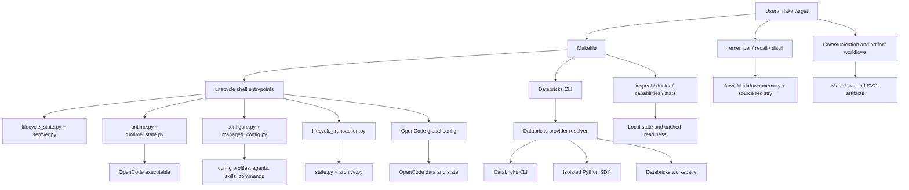

# Anvil System Map

This map describes the repository at Anvil 2.10.0. It follows the public Make targets through configuration, lifecycle, runtime, providers, persistent state, and local verification. The companion [quality audit](quality-audit.md) records evidence, findings, and confidence.

## Shape and data flow

Anvil owns the global OpenCode harness, its lifecycle, explicit Markdown memory, source provenance, and local task-materialization helpers. OpenCode owns model/provider selection, authentication, sessions, its runtime database, and shell/filesystem execution. Databricks is an optional integration and its readiness does not define core Anvil health.

## Executable inventory

The repository contains 56 Python files and 15 shell files under `scripts/` (71 executable source files), 5 top-level test drivers, and 35 files under `config/`. The eight shipped skills and four slash commands are versioned in [`config/managed-inventory.json`](../config/managed-inventory.json). OpenCode profiles and runtime policy are under `config/`; release behavior is described in the changelog, version notes, migration notes, and command contracts.

| Subsystem | Main modules and entrypoints | Inputs → outputs | Persistent state / external dependency | Failure boundary and test evidence |
|---|---|---|---|---|
| Public command API | [`Makefile`](../Makefile), `scripts/{inspect,doctor,stats,test}.sh`, `scripts/capabilities.py`, `scripts/databricks.py`, `scripts/rollback.sh` | Make target and variables → human output or documented JSON | None for read-only targets; `make` and Bash | Exit meanings are defined in [command contracts](command-contracts.md); fresh and installed matrices run in `tests/lifecycle.py` |
| Install and rebuild | `scripts/reforge.sh`, `scripts/lib/install.sh`, `scripts/install-opencode.sh`, `scripts/path_edit.py` | Current HOME/XDG state + runtime policy → staged config/runtime and postflight | OpenCode binary under `$HOME/.opencode`; config under `$XDG_CONFIG_HOME/opencode`; first install may require release network access | Preflight, rehearsal, backup, confirmation, transactional activation; first-install and repeat-reforge fixtures |
| Anvil upgrade | `scripts/anvil_upgrade.sh`, `scripts/managed_config.py`, `scripts/configure.py`, `scripts/backup_preflight.py` | Valid source profile + Anvil checkout → target file plan and managed config | Anvil config, installation metadata, backup/journal; no network and no OpenCode download | Supported-source audit, collision detection, path write check, quiesce, backup, staged replacement, postflight; version, ownership, dry-run, process and read-only tests |
| Runtime update/migration | `scripts/upgrade.sh`, `scripts/opencode_release.py`, `scripts/opencode_v1_release.py`, `scripts/validate-candidate.sh`, `scripts/rehearse-upgrade.sh` | Release policy/selected major → exact candidate and rehearsed runtime profile | OpenCode executable, data and state; official release endpoints when invoked | Exact candidate validation before mutation; rollback on post-mutation failure; offline fixture, 403 and rollback tests |
| Lifecycle state and versioning | `scripts/lifecycle_state.py`, `scripts/semver.py`, `scripts/lifecycle_transaction.py`, `scripts/installation.py` | Metadata, config manifest, runtime, backups, journal → shared state classification | `$XDG_DATA_HOME/anvil/{installation.json,runtime.json,lifecycle-transaction.json}` | SemVer ordering, source-window and future-version checks, journal recovery, malformed-state matrix |
| Snapshot and restore | `scripts/lib/backup.sh`, `scripts/state.py`, `scripts/archive.py`, `scripts/rollback.sh` | Config/runtime files and selected scope → checksummed snapshot or restored tree | `$XDG_DATA_HOME/anvil/backups/`; runtime-scope archives can contain OpenCode session/auth state | Snapshot verification, archive path checks, scope-aware restore, interrupted activation recovery; lifecycle and rollback tests |
| Runtime adapter | `scripts/runtime.py`, `scripts/runtime_state.py`, `scripts/runtime_processes.py`, `scripts/runtime_quiesce.py`, `scripts/active-opencode.py` | Candidate executable, runtime policy, process table → version, generation, support, capabilities and quiesce result | Runtime identity cache under Anvil XDG roots; OpenCode process table | Bounded version calls, executable identity checks, same-user/configured-path matching; V1/V2 wrappers, PATH loss and signal-order tests |
| Configuration generation | `scripts/configure.py`, `scripts/managed_config.py`, `config/opencode.jsonc`, `config/runtimes/`, `config/runtime-policy.json`, `config/managed-inventory.json` | Runtime major, source profile, release inventory, preferences → generated V1/V2 profile and ownership manifest | Installed OpenCode global config and checksummed `.anvil-managed.json` | Strict target audit and source-compatible audit are separate; migration tests cover additions/removals, collisions, preferences, custom disabled agents, and manifests |
| Agents, skills and commands | `config/AGENTS.md`, `config/skills/*`, `config/commands/*`, `config/plugins/anvil-core/` | OpenCode request/context → Anvil agent guidance, lazy skills, explicit slash command, bounded V2 memory tool | Installed global profile; Markdown memory only through explicit write commands/user intent | Shipped-set consistency gate, V1/V2 config fixtures, distill and communication contract suites; actual model behavior is outside deterministic tests |
| Memory and source provenance | `scripts/memory.py`, `scripts/source_registry.py`, `/remember`, `/recall`, `/distill` | Explicit text/source paths and query → Markdown entry, bounded recall, source record and drift signals | `$XDG_DATA_HOME/anvil/{memory,sources}` | Atomic file writes; search has a standard-library fallback when `rg` is absent; tests cover validation, provenance, dedupe, source drift and no-write search |
| Databricks bootstrap/readiness | `scripts/databricks.py`, `scripts/databricks_providers/{owned_config,topology,auth_strategy,auth,readiness,presentation}.py` | Workspace and selected auth flow → staged Anvil profile and readiness evidence | `$XDG_CONFIG_HOME/anvil/databricks*`; user-local CLI/isolated SDK under Anvil data; credentials are delegated to supported providers | Profile isolation, child-env sanitation, timeouts, bounded subprocesses, staged activation, provider-scoped fallback; local CLI/auth fakes only |
| Databricks discovery/execution/FinOps | `scripts/databricks_providers/{resolver,discovery,process,sdk,sql_connector}.py`, `scripts/databricks_finops.py`, Databricks skills and SQL recipes | Read-only provider operations and bounded results → normalized workspace/resource/query/FinOps evidence | Optional provider state/cache; live workspace and optional specialized SDK/connector packages | Permission, timeout, result-size, mutation-policy, query-schema and evidence scenarios use fixtures; no live workspace execution was performed |
| Communication and artifacts | `scripts/artifacts.py`, `scripts/communication/{inputs,contracts,quantitative,planning,materialize,diagrams,review}.py`, `anvil-communication`, `/review` | Named local inputs + evidence/plan → bounded extraction, analysis, Markdown or accessible SVG, review findings | User-selected output files; no memory write or remote lookup | Size/type/symlink checks, provenance and recomputed metrics, no-overwrite rules, SVG layout validation; deterministic offline tests |
| Inspect/doctor/capabilities/stats | `scripts/inspect_data.py`, `scripts/doctor_data.py`, `scripts/capabilities.py`, `scripts/stats.sh`, `scripts/stats.py` | Current HOME/XDG/runtime and optional cached provider state → human or JSON diagnostics | Read-only apart from temporary stats output, removed on exit | Public exit/output contracts, first-use/partial/corrupt states, no-runtime stats and structured formatter fixtures |
| Adaptive engineering and continuity | `scripts/engineering.py`, `scripts/engineering/`, task-local assessment, lazy engineering/system-design and deep Spark skills | Current task evidence → direct action or selected requirements/architecture/work/domain branch → proportional checks | Optional XDG task generations; local work leaves unrelated active project state dormant | No repo-size activation; path-scoped stale evidence; milestone checkpoint reuses valid invariants; atomic resume/coverage gates and paired offline replays |
| Test/release integrity | `scripts/test.sh`, `tests/run.sh`, test drivers, `scripts/version_docs.py`, `docs/RELEASING.md` | Repo tree and local fixtures → offline assurance and release consistency result | Temporary HOME/XDG and fixtures; no external network in lifecycle suite | Python/shell syntax, shipped-set/version docs, fake OpenCode/Databricks, denied external network; static third-party linters unavailable in this environment |

## Public commands and side effects

| Target | Intent | Network | Mutates user state? |
|---|---|---:|---:|
| `make help` | Show commands and lifecycle guidance | No | No |
| `make inspect` | Read-only installation/runtime/config inventory | No | No |
| `make test` | Offline fixtures and lifecycle regression suite | No | Test-only temporary paths |
| `make reforge` | First install or explicit recovery/rebuild; reuses an existing compatible runtime | Only when provisioning a missing runtime | Yes; scoped config/runtime/bootstrap changes with snapshot |
| `make upgrade [DRY_RUN=1]` | Migrate Anvil while preserving exact OpenCode runtime/data/state | No | Yes on real run; config/Anvil metadata only |
| `make update-runtime [DRY_RUN=1]` | Update OpenCode within its current major | Yes | Yes on real run |
| `make migrate-runtime OPENCODE_MAJOR=1|2 [DRY_RUN=1]` | Explicit runtime-major and profile transition | Yes | Yes on real run |
| `make rollback` | Restore latest verified snapshot by recorded scope | No | Yes |
| `make doctor` | Diagnose lifecycle, project and configured Databricks readiness | Conditional: read-only workspace checks for configured profile | No |
| `make capabilities [FORMAT=json]` | Report supported/local/cached capabilities | No | No |
| `make stats` | Runtime-native stats or honest unavailable result | No | Temporary output only |
| `make databricks-setup [DRY_RUN=1]` | Set up the optional Anvil-owned provider | Dry-run: no; real setup may contact official sources/workspace | Real setup only |

There is no `make setup` target. `make` prints help; fresh installation uses the documented `make reforge` journey. Supported external-cwd invocation is `make -C /path/to/anvil TARGET`; recipes use repository-relative paths after Make changes into that directory.

## State locations and ownership

| Data | Location | Owner and lifecycle behavior |
|---|---|---|
| OpenCode global config and Anvil harness | `$XDG_CONFIG_HOME/opencode` (default `~/.config/opencode`) | Anvil owns manifest-listed paths; user extras and `cli.json`, `tui.json`, `tui.jsonc` are preserved. The manifest hash is pinned in installation metadata. |
| OpenCode executable | `$HOME/.opencode/bin/opencode` | Managed runtime path. Anvil upgrade preserves the exact binary; runtime-specific commands may replace it. |
| OpenCode user data and state | `$XDG_DATA_HOME/opencode`, `$XDG_STATE_HOME/opencode` | OpenCode-owned. Anvil-only upgrade/reforge never copies or rewrites it; runtime backups include it opaquely. |
| Anvil release/runtime/transaction record | `$XDG_DATA_HOME/anvil/{installation.json,runtime.json,lifecycle-transaction.json}` | Anvil-owned, versioned/validated, private lifecycle state. A pending journal blocks a second mutation until snapshot recovery. |
| Anvil backups | `$XDG_DATA_HOME/anvil/backups` | Checksummed scope-specific snapshots. Memory/knowledge/source registry are deliberately outside runtime snapshots. |
| Engineering task state | `$XDG_STATE_HOME/anvil/engineering/<repo-id>/<task-id>/` | Optional project/task JSON, separate Requirements/Architecture/Work models. Explicit init/update/archive; outside config/runtime rollback snapshots and durable memory. |
| Anvil memory, knowledge, sources | `$XDG_DATA_HOME/anvil/{memory,knowledge,sources}` | Separate user data; Markdown remains memory source of truth. Upgrade/reforge preserve it. |
| Databricks profile/provider state | `$XDG_CONFIG_HOME/anvil/databricks/` and `anvil/databricks.json` | Anvil-owned profile and non-secret readiness metadata; external Databricks profiles are read-only diagnostics and are not adopted. |
| Databricks client installs | Under Anvil XDG data | Explicit setup may install a user-local CLI or isolated SDK; general Anvil lifecycle does not. Provider-native credential storage handles secrets. |

All lifecycle integration tests use isolated HOME and XDG roots. File manifests reject unsafe relative paths and symlinks at Anvil-owned paths; unowned config entries are inventoried without following symlinks, excluded from Anvil hashes, and preserved during migration. Snapshot restore verifies archive contents before activation. Runtime process matching is scoped to the validated executable, current user, and configured OpenCode data roots.

## External dependency inventory

Core lifecycle and tests require Python 3.11+, Bash, GNU Make, `tar`, and ordinary POSIX file/process utilities used by each command (`cp`, `mv`, `install`, `chmod`, `date`, `ps`, `find`, `rm`). Ripgrep (`rg`) is optional; memory search falls back to Python. The OpenCode executable is needed to run the harness, but an absent runtime is a valid first-use state. Network access is limited to clean runtime provisioning and explicit runtime update/migration, and to optional Databricks setup/doctor workspace probes. No model request is part of install, test, inspect, upgrade, stats formatting, memory search, or artifact-core tests.
